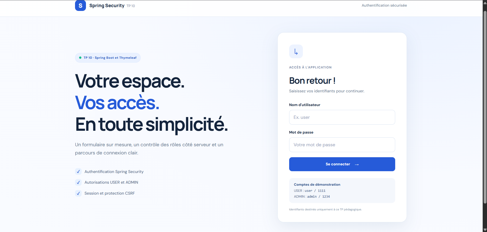
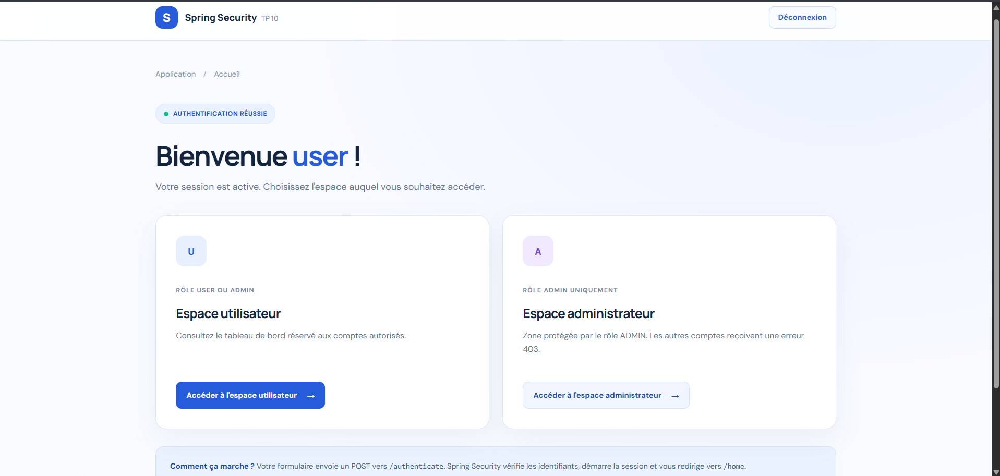
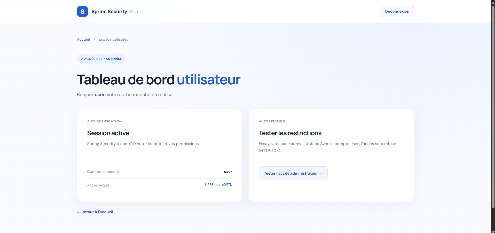
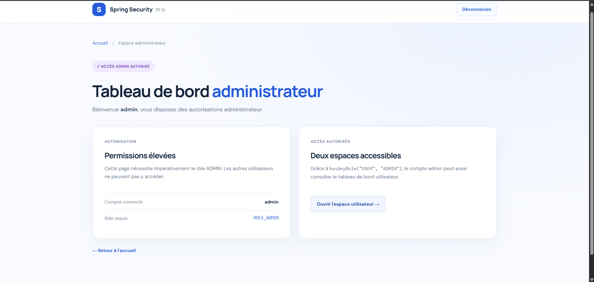
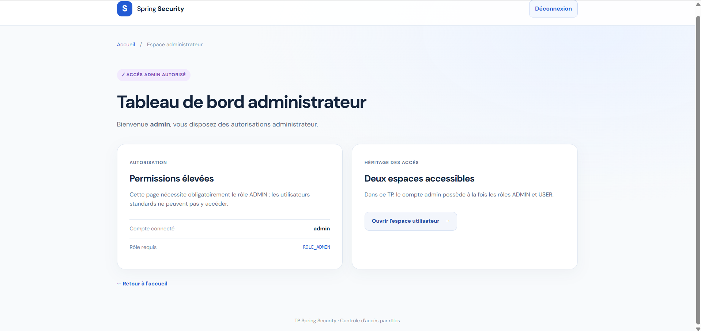

# TP 10 — Formulaire de connexion personnalisé avec Spring Security

**Module :** Développement JakartaEE — Spring  
**Projet :** `tp10-spring-security-login-personnalise`  
**Technologies :** Java 17 · Spring Boot 3.5.16 · Spring Security · Spring MVC · Thymeleaf · Maven · HTML/CSS

Ce projet réalise le **TP 10 « Formulaire de connexion personnalisé »** : une application Spring Boot avec un formulaire Thymeleaf sur mesure, un traitement d'authentification assuré par Spring Security, des redirections, la gestion des messages de connexion et de déconnexion, et des accès distincts pour les rôles **USER** et **ADMIN**.

> **État du projet :** les quatre premières captures ci-dessous proviennent de l'exécution du TP 10. Le projet contient également des tests automatisés ; lancez `mvn test` pour les vérifier sur votre machine.

---

## 1. Aperçu de l'application

### 1.1. Page de connexion personnalisée

Le formulaire HTML envoie une requête **POST `/authenticate`**, traitée directement par Spring Security. Il comprend les champs `username` et `password` et utilise le jeton CSRF fourni par Thymeleaf.



### 1.2. Page d'accueil après connexion

Après une connexion réussie, l'application redirige systématiquement vers **`/home`**. La page accueille l'utilisateur connecté et présente les espaces disponibles.



### 1.3. Tableau de bord utilisateur

La route **`/user/dashboard`** est accessible aux comptes possédant le rôle **USER ou ADMIN**. Elle affiche le compte connecté et permet de tester les restrictions d'accès.



### 1.4. Tableau de bord administrateur

La route **`/admin/dashboard`** est réservée au rôle **ADMIN**. Le compte administrateur peut aussi consulter l'espace utilisateur, conformément à la règle `hasAnyRole("USER", "ADMIN")`.



<details>
<summary><strong>Capture supplémentaire — référence du TP 9 (comparaison)</strong></summary>

La cinquième capture fournie correspond à l'interface administrateur du **TP 9**, et non à celle du TP 10 (elle n'affiche pas la mention « TP 10 »). Elle est conservée comme **élément de comparaison**, sans être présentée comme un résultat de ce projet.



</details>

---

## 2. Objectifs pédagogiques

- Remplacer la page de connexion native de Spring Security par un **template Thymeleaf** personnalisé.
- Comprendre le cheminement d'une requête à travers `SecurityFilterChain`.
- Faire traiter les identifiants par Spring Security via **`/authenticate`**.
- Rediriger vers **`/home`** après un succès et vers **`/login?error=true`** après un échec.
- Gérer **`POST /logout`** et le message **`/login?logout=true`**.
- Appliquer des autorisations distinctes pour **USER** et **ADMIN**.
- Conserver la **protection CSRF** et encoder les mots de passe de démonstration avec **BCrypt**.

## 3. Prérequis

| Outil | Version |
|---|---|
| JDK | **17 ou supérieur** (17 ou 21 recommandés) |
| Maven | 3.9.x ou version compatible |
| IDE | IntelliJ IDEA, Eclipse ou VS Code (facultatif) |
| Navigateur | Chrome, Firefox ou Edge |

Sous **Windows / PowerShell**, vérifier :

```powershell
java -version
mvn -version
$env:JAVA_HOME
```

**Attention :** Spring Boot 3.5.16 ne fonctionne pas avec Java 8. Si Maven affiche `Java version: 1.8`, il faut configurer `JAVA_HOME` vers un JDK 17 ou 21, puis rouvrir le terminal.

## 4. Installation et lancement

1. Décompresser le ZIP.
2. Ouvrir le dossier **`tp10-spring-security-login-personnalise`** dans l'IDE (c'est celui qui contient `pom.xml`).
3. Attendre le téléchargement des dépendances Maven.
4. Démarrer l'application.

**Lancement standard (port 8080) :**

```powershell
mvn clean spring-boot:run
```

Accéder à : <http://localhost:8080/login>

**Lancement sur le port 8082** (recommandé si le TP 9 utilise déjà 8081 ou si 8080 est occupé) :

```powershell
mvn clean spring-boot:run "-Dspring-boot.run.arguments=--server.port=8082"
```

Accéder à : <http://localhost:8082/login>

Pour arrêter le serveur, utiliser **Ctrl + C** dans le terminal.

## 5. Comptes de démonstration

| Identifiant | Mot de passe | Rôle | Accès |
|---|---|---|---|
| `user` | `1111` | `ROLE_USER` | Espace utilisateur |
| `admin` | `1234` | `ROLE_ADMIN` | Espaces utilisateur **et** administrateur |

Les utilisateurs sont définis dans `InMemoryUserDetailsManager`. Les mots de passe sont encodés à l'aide de **`BCryptPasswordEncoder`**. Il s'agit uniquement de comptes pédagogiques : leurs mots de passe sont trop simples et leur affichage public est à proscrire en production.

## 6. Architecture du projet

```text
tp10-spring-security-login-personnalise/
├── .gitignore
├── pom.xml
├── README.md
├── docs/
│   └── screenshots/
│       ├── 01-connexion.png
│       ├── 02-accueil-apres-connexion.png
│       ├── 03-espace-utilisateur.png
│       ├── 04-espace-administrateur.png
│       └── 05-comparaison-tp9-administrateur.png
└── src/
    ├── main/
    │   ├── java/ma/fstg/security/
    │   │   ├── SpringSecurityLoginApplication.java
    │   │   ├── config/SecurityConfig.java
    │   │   └── web/AuthController.java
    │   └── resources/
    │       ├── application.properties
    │       ├── static/css/style.css
    │       └── templates/
    │           ├── login.html
    │           ├── home.html
    │           ├── user-dashboard.html
    │           ├── admin-dashboard.html
    │           └── access-denied.html
    └── test/java/ma/fstg/security/
        └── AuthenticationFlowTests.java
```

### Responsabilités des composants

| Fichier | Responsabilité |
|---|---|
| `SecurityConfig.java` | Chaîne de filtres, règles d'accès, formulaire personnalisé, déconnexion, utilisateurs en mémoire et BCrypt |
| `AuthController.java` | Routage des vues HTML et transmission du nom de l'utilisateur connecté |
| `login.html` | Formulaire POST `/authenticate` et messages conditionnels Thymeleaf |
| `home.html` | Accueil de l'utilisateur authentifié et navigation |
| `user-dashboard.html` | Tableau de bord réservé aux rôles USER et ADMIN |
| `admin-dashboard.html` | Tableau de bord réservé au rôle ADMIN |
| `access-denied.html` | Affichage personnalisé du refus d'accès HTTP 403 |
| `style.css` | Mise en page et style responsive des interfaces |
| `AuthenticationFlowTests.java` | Tests de connexion, redirections, rôles, déconnexion et CSRF |

## 7. Fonctionnement de l'authentification

```text
Utilisateur non authentifié
      │
      ▼
GET /user/dashboard ────► SecurityFilterChain
                                 │ accès protégé
                                 ▼
                            GET /login
                                 │
                                 ▼
                       Formulaire Thymeleaf
                                 │
                        POST /authenticate
                        (avec jeton CSRF)
                                 │
                      Spring Security vérifie
                       les identifiants
                         /           \
                    SUCCÈS           ÉCHEC
                       │               │
                       ▼               ▼
                     /home       /login?error=true
                       │
              ┌────────┴────────┐
              ▼                 ▼
      /user/dashboard    /admin/dashboard
        USER ou ADMIN      ADMIN uniquement

POST /logout + CSRF  ──► /login?logout=true
```

**À retenir :** le contrôleur MVC n'implémente pas `POST /authenticate`. Le traitement est assuré par Spring Security grâce à `loginProcessingUrl("/authenticate")`.

### Règles de sécurité

| Route | Méthode | Accès / résultat |
|---|---|---|
| `/login` | GET | Public : formulaire personnalisé |
| `/authenticate` | POST | Traitement de la connexion ; jeton CSRF requis |
| `/home` | GET | Authentification obligatoire |
| `/user/dashboard` | GET | Rôles USER ou ADMIN |
| `/admin/dashboard` | GET | Rôle ADMIN uniquement |
| `/logout` | POST | Déconnexion ; jeton CSRF requis |
| `/css/**` | GET | Ressources publiques |

Le compte `user` reçoit un **403** s'il essaie d'ouvrir `/admin/dashboard`. En revanche, le compte `admin` peut consulter les deux tableaux de bord.

## 8. Extraits importants de configuration

La chaîne de sécurité configure :

```java
.formLogin(form -> form
    .loginPage("/login")
    .loginProcessingUrl("/authenticate")
    .defaultSuccessUrl("/home", true)
    .failureUrl("/login?error=true")
    .permitAll()
)
.logout(logout -> logout
    .logoutUrl("/logout")
    .logoutSuccessUrl("/login?logout=true")
    .invalidateHttpSession(true)
    .deleteCookies("JSESSIONID")
    .permitAll()
);
```

Et le formulaire utilise :

```html
<form th:action="@{/authenticate}" method="post">
    <input type="text" name="username" required>
    <input type="password" name="password" required>
    <button type="submit">Se connecter</button>
</form>
```

L'intégration entre Spring Security et Thymeleaf permet l'insertion automatique du champ CSRF dans les formulaires POST utilisant `th:action`. Les formulaires de déconnexion sont aussi envoyés en POST ; **CSRF n'est pas désactivé**.

## 9. Tests et validation

### Scénarios à vérifier manuellement

| N° | Action | Résultat attendu |
|---|---|---|
| 1 | Ouvrir `/home` sans être connecté | Redirection vers `/login` |
| 2 | Saisir `user / 1111` | Redirection vers `/home` |
| 3 | Ouvrir `/user/dashboard` en étant `user` | Accès autorisé |
| 4 | Ouvrir `/admin/dashboard` en étant `user` | **403 — Accès refusé** |
| 5 | Se connecter avec `admin / 1234` | Accès aux espaces utilisateur et administrateur |
| 6 | Saisir un mauvais mot de passe | `/login?error=true` avec message d'erreur |
| 7 | Cliquer sur « Déconnexion » | `/login?logout=true` avec message de confirmation |
| 8 | Envoyer un POST sans jeton CSRF | **403** |

La galerie de captures documente les écrans effectivement fournis : **connexion, accueil authentifié, espace utilisateur et espace administrateur**. Elle ne contient pas de capture distincte de l'erreur 403 ni du message après déconnexion ; ces scénarios peuvent être contrôlés manuellement.

### Tests automatisés avec Maven

```powershell
mvn test
```

Le fichier `AuthenticationFlowTests.java` définit **10 méthodes de test**, couvrant notamment la page de login, les redirections, les autorisations, la déconnexion et le refus des requêtes sans CSRF.

> Les tests sont fournis avec le code source. Leur résultat n'est pas affirmé ici : il dépend de l'exécution effective de la commande `mvn test`.

## 10. Différence entre les TP 9 et 10

- **TP 9 :** configuration des utilisateurs en mémoire, des rôles, des mots de passe encodés et des règles d'accès aux routes. Il introduit également une interface de connexion personnalisée.
- **TP 10 :** approfondissement du **flux d'authentification** : formulaire sur mesure, action `/authenticate`, redirections explicites vers `/home`, messages en cas d'échec et de déconnexion, et présentation adaptée.

Les deux projets sont indépendants et peuvent fonctionner simultanément sur des ports distincts (par exemple 8081 et 8082).

## 11. Limites et pistes d'amélioration

Cette application a un objectif **pédagogique**. Avant toute mise en production, il faudrait notamment utiliser une base de données pour les comptes, une politique de mots de passe robuste, une configuration HTTPS, des protections contre les tentatives répétées et une gestion de session adaptée.

---

**Conclusion :** le TP 10 montre comment personnaliser l'expérience de connexion avec Thymeleaf sans réécrire le mécanisme d'authentification de Spring Security, tout en conservant le contrôle des rôles et les protections essentielles.
